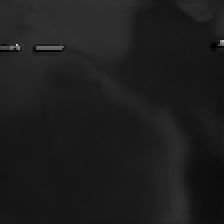
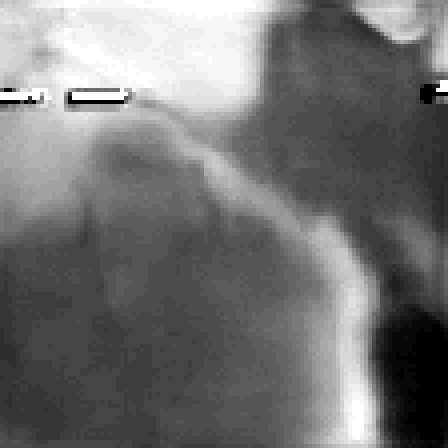
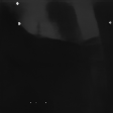
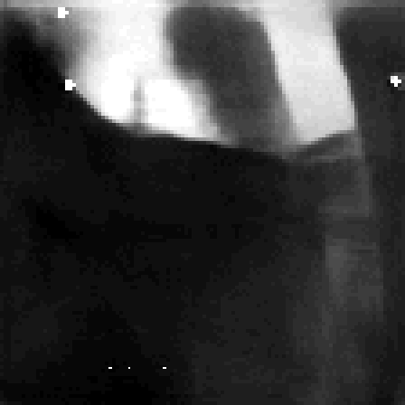
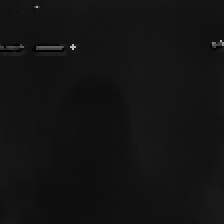
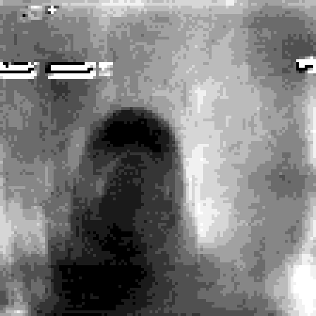

# NE302 FastDepth SoftAP MQTT Evaluation Report

| Field | Value |
|-------|-------|
| Date | 2026-10-30 |
| Platform | NeoEyes NE302 (STM32N6 + SiWx917) |
| App under test | `v4.3.1.334` @ `0x70100000` |
| Model | FastDepth **224** NYU Depth V2 INT8 |
| Output | 224×224 uint8 grayscale |
| SoftAP MQTT interval | ~30 s |
| FastDepth 320 | Out of scope (cancelled) |

## One-line conclusion

SoftAP + a laptop-local MQTT broker can deliver FastDepth **224×224 grayscale** depth about every **30 seconds** for customer link verification. SoftAP is demo/provisioning grade, not high-rate production. Depth quality does **not** match paper Proposed2.

| Criterion | Result |
|-----------|--------|
| SoftAP web UI | Pass |
| MQTT to SoftAP laptop IP:1883 | Pass |
| ~30 s depth, SoftAP held | Conditional pass (pacing + AP retain) |
| 224×224 native grayscale | Pass |
| Paper Proposed2 quality | Fail / out of scope |
| FastDepth 320 option | Not delivered |

## Topology

```
[NE302 SoftAP 192.168.10.10] <-- Wi-Fi NE302_… --> [Laptop Wi-Fi 192.168.10.x]
   Web UI + FastDepth NPU                          MQTT broker :1883 + viewer
```

**Rule:** MQTT Server must be the laptop SoftAP IPv4 (e.g. `192.168.10.101`), **not** Ethernet `192.168.1.x`.

## Firmware retained (224 / 30 s / SoftAP retain)

| File | Role |
|------|------|
| `mqtt_service.c` | Wait SoftAP **or** STA before MQTT |
| `web_server.c` | Do not idle-kill SoftAP while MQTT connected |
| `video_ai_node.c` | SoftAP w/o MQTT skip FastDepth; w/ MQTT ~30 s; full-res gray |
| `depth_eval_config.h` | Intervals = 30000 ms |

## Test process

1. Flash App **334** @ `0x70100000`; FastDepth 224 in AI slot.
2. Join SoftAP; ping `192.168.10.10`; open web UI.
3. Start broker on PC `:1883`.
4. Negative: MQTT = Ethernet IP → timeout. Correct: MQTT = SoftAP IP → connect.
5. Receive ≥3 depth frames ≈ every 30 s; SoftAP stays up ≥5 minutes.

## Quantitative notes

| Metric | Value |
|--------|-------|
| Resolution | 224×224 |
| SoftAP interval | ~30 s |
| Example infer (viewer) | ~56 ms |
| Raw mean luminance | ~16–29 / 255 |

## Depth quality

Lightweight FastDepth 224 INT8, not Proposed2. Raw maps look near-black; contrast stretch shows coarse near/far structure. Accept the SoftAP MQTT link demo, not paper screenshot equality.

## Sample SoftAP MQTT images (3 frames)

Images are under `fastdepth_eval_samples/` at the **repository root** (not under `docs/`).

### Sample 1 — 16:14:04

Raw (as received):



Contrast-stretched (viewing aid only):



### Sample 2 — 16:22:38

Raw:



Stretched:



### Sample 3 — 16:30:41

Raw:



Stretched:



## Risks and recommendations

- SoftAP + NPU + large MQTT is demo-only; prefer **STA** for production.
- Wrong MQTT IP (Ethernet vs SoftAP) is a common false failure.
- Do not gate acceptance on Proposed2 visuals; do not promise FastDepth 320 without a new SOW.

---

*Engineering evaluation record (2026-10-30). Not a third-party lab certificate.*
